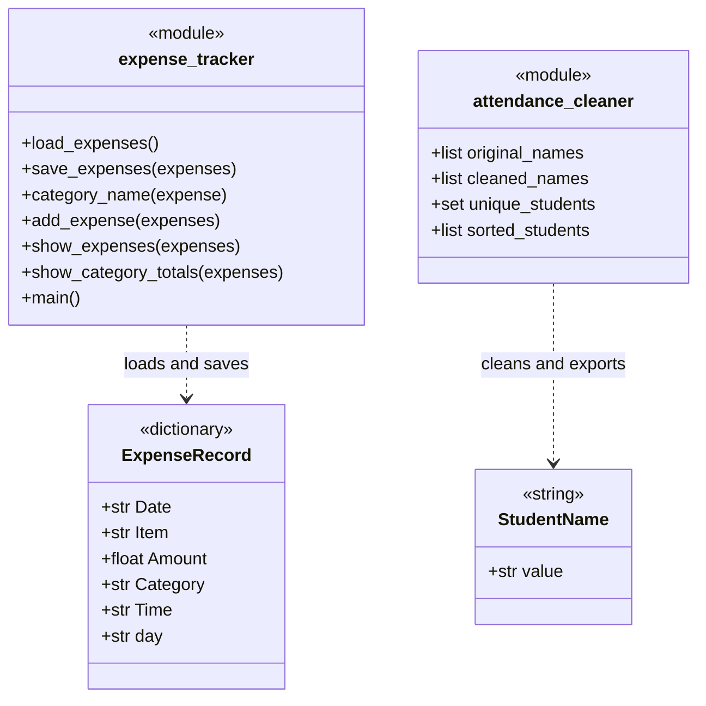
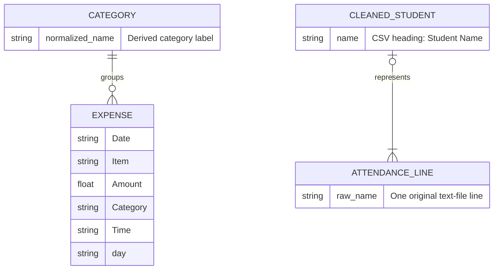

# Python Files & Error Handling Assessment

**Record expenses. Clean attendance. Practice reliable file handling.**

Two independent Python command-line applications for an institute: an expense tracker that retains records between runs, and an attendance cleaner that turns repeated, inconsistently formatted names into an alphabetical CSV.

| Application | Input | Result |
| --- | --- | --- |
| **Institute Expense Tracker** | Menu entries and an optional existing expense CSV | Saved expenses, a readable expense list, and totals by category |
| **Student Attendance Cleaner** | One student name per line in `attendance.txt` | A unique, sorted list in `attendance_clean.csv`, plus record counts |

**Dependencies:** Python standard library only. **Validation:** 23 scenarios passed on Python 3.12.14.

## Contents

- [Executive summary](#executive-summary)
- [Repository structure](#repository-structure)
- [Getting started](#getting-started)
- [Expense tracker](#expense-tracker)
- [Attendance cleaner](#attendance-cleaner)
- [Sets and comprehensions](#sets-and-comprehensions)
- [Use cases](#use-cases)
- [Design diagrams](#design-diagrams)
- [Errors handled and data protection](#errors-handled-and-data-protection)
- [Sample runs](#sample-runs)
- [Test cases](#test-cases)
- [Troubleshooting](#troubleshooting)
- [Current boundaries](#current-boundaries)
- [Submission checklist](#submission-checklist)
- [Conclusion](#conclusion)

## Executive summary

This project applies Python fundamentals to two everyday record-keeping problems: retaining expense history and removing duplicate attendance entries. Both tools use plain files that are easy to inspect and require no database or third-party packages.

The expense tracker loads previous records at startup, validates amounts, groups expenses by category, and saves updates through a temporary file. If existing expense data cannot be loaded, it stops before offering edits. The attendance cleaner standardizes names before removing duplicates, so entries such as `ali khan` and `ALI KHAN` become one student entry.

Together, the programs demonstrate file input/output, CSV processing, exception handling, functions, lists, dictionaries, sets, comprehensions, and data persistence. A verified two-session example below shows an expense being saved, the program closing, and the same expense being loaded again.

## Repository structure

Keep these four submission files at the repository root:

| File | Purpose |
| --- | --- |
| [`expense_tracker.py`](expense_tracker.py) | Interactive expense entry, loading, saving, display, and category totals |
| [`attendance_cleaner.py`](attendance_cleaner.py) | Attendance cleaning, duplicate removal, sorting, and CSV export |
| [`attendance.txt`](attendance.txt) | Sample attendance input with 15 records and 8 unique cleaned names |
| [`README.md`](README.md) | Setup, usage, diagrams, error handling, examples, and test cases |

Files used or generated while running the programs:

| File | Behavior |
| --- | --- |
| `myExpenses1.csv` | Loaded if present; created on the first successful expense save |
| `myExpenses1.tmp` | Temporary expense file used before replacing the main CSV; may remain after a failed save |
| `attendance_clean.csv` | Created or replaced each time attendance cleaning completes |

The expense CSV is optional for the first run. To continue using an existing dataset, place `myExpenses1.csv` beside `expense_tracker.py` with the headings documented below.

## Getting started

### Requirements

- Python 3; the documented checks used **Python 3.12.14**.
- A terminal, such as PowerShell, Command Prompt, or a Linux/macOS terminal.
- The four repository files listed above.

No `pip install` step is required. The programs use `csv`, `math`, and `pathlib` from Python's standard library.

### Open the project folder

In PowerShell, change into the folder containing your files:

```powershell
cd "E:\Python\python_week_01\Practice_python"
python --version
```

Replace the example path with your own project folder.

### Run the expense tracker

```bash
python expense_tracker.py
```

Choose a menu option, follow the prompts, and enter `4` to exit.

### Run the attendance cleaner

Ensure `attendance.txt` is present, then run:

```bash
python attendance_cleaner.py
```

On systems where Python is available as `python3`, use that command instead of `python`.

**File location matters:** the expense tracker uses the folder containing `expense_tracker.py` for its CSV. The attendance cleaner reads and writes files in the terminal's **current working directory**. Running both commands from the repository root keeps all files together.

## Expense tracker

### Menu

| Option | Action |
| --- | --- |
| `1` | Add a new expense and save it immediately |
| `2` | Display all loaded and newly saved expenses |
| `3` | Display unique categories and their totals |
| `4` | Exit the program |

### CSV structure

The saved header is:

```csv
Date,Item,Amount,Category,Time,day
```

| Field | Example | Handling |
| --- | --- | --- |
| `Date` | `14/11/2026` | Required text for a new expense |
| `Item` | `Notebook` | Required text; surrounding spaces removed |
| `Amount` | `250.0` | Converted to a finite, non-negative `float` |
| `Category` | `stationery` | New entries are trimmed and lowercased |
| `Time` | `09:30` | Required text for a new expense |
| `day` | `Saturday` | Required text; new entries use title case |

Heading names are case-sensitive: `day` must remain lowercase. The loader accepts these headings in a different order and supports a UTF-8 byte order mark through `utf-8-sig`.

### How it works

1. `load_expenses()` reads existing CSV records and converts each amount to a number.
2. `main()` presents the menu, provided loading succeeded.
3. `add_expense()` collects required fields and repeats the amount prompt until the value is valid.
4. `save_expenses()` writes the complete updated list to `myExpenses1.tmp`, then replaces `myExpenses1.csv`.
5. The new expense is appended to the in-memory list only after saving succeeds.
6. `show_expenses()` displays amounts with two decimal places. `show_category_totals()` groups and sums expenses using normalized category names.

An existing blank category is displayed and totaled as `uncategorized`. A new expense requires a nonblank category. Category normalization used for reporting does not rewrite existing category text in the stored records.

## Attendance cleaner

### Input

`attendance.txt` contains one name per line. For example:

```text
  ali khan  
SARA AHMED
ali KHAN
  bilal hassan
```

### Cleaning process

| Step | Operation | Purpose |
| --- | --- | --- |
| Read | `file.readlines()` | Keep the original lines for counting and cleaning |
| Clean | `strip()` and `title()` | Remove surrounding whitespace and standardize capitalization |
| Filter | `if name.strip()` | Exclude empty and whitespace-only lines |
| Deduplicate | `set(cleaned_names)` | Keep one copy of each cleaned name |
| Sort | `sorted(unique_students)` | Return the unique names in alphabetical order |
| Export | `csv.writer()` | Write the `Student Name` heading and one name per row |

The original record count includes **every input line**, including blank lines. The unique count excludes blank names. The cleaned CSV is regenerated on each successful run.

## Sets and comprehensions

### List comprehension: cleaning attendance

```python
cleaned_names = [
    name.strip().title()
    for name in original_names
    if name.strip()
]
```

- `for name in original_names` visits each original line.
- `if name.strip()` keeps only lines containing non-whitespace characters.
- `name.strip().title()` produces the cleaned name.
- The square brackets collect the results into a new **list**. Duplicates can still exist at this stage.

### Set: unique students

```python
unique_students = set(cleaned_names)
sorted_students = sorted(unique_students)
```

A set removes repeated cleaned names. `len(unique_students)` gives the unique student count. Because sets do not provide alphabetical ordering, `sorted()` creates the final ordered list.

### Set comprehension: unique expense categories

```python
categories = {category_name(expense) for expense in expenses}
```

The braces create a **set comprehension**. `category_name()` trims and lowercases each category, using `uncategorized` when a stored category is blank. This makes `Food`, `food`, and ` food ` part of the same reporting group.

Category totals use `sum()` with a generator expression to add matching amounts without creating another list.

## Use cases

| ID | User goal | Action | Successful outcome |
| --- | --- | --- | --- |
| UC01 | Record institute spending | Select `1` and enter a valid expense | A new row is saved and retained after restart |
| UC02 | Review expense history | Select `2` | All loaded and newly saved expenses are displayed |
| UC03 | Understand spending by category | Select `3` | Each normalized category and its total are displayed |
| UC04 | Continue a previous session | Restart the expense tracker | Existing valid CSV records are loaded automatically |
| UC05 | Correct an invalid amount | Enter a valid value after a rejected amount | The valid amount is saved once |
| UC06 | Clean an attendance register | Run the cleaner with `attendance.txt` available | A sorted, duplicate-free CSV is generated |
| UC07 | Check attendance counts | Read the cleaner's terminal output | Original and unique counts are displayed |
| UC08 | Diagnose an invalid expense file | Start the tracker with incorrect headings or invalid stored amounts | A useful error is shown and editing does not begin |

## Design diagrams

### Class diagram

This is a **conceptual class view of the procedural code**. The two module boxes represent Python files, `ExpenseRecord` represents a dictionary, and `StudentName` represents a string. The implementation does not define custom Python classes.



### Entity relationship diagram

This diagram describes **logical data relationships in the files and calculated results**. The project uses text and CSV files; it does not implement database tables, primary keys, or foreign keys. `CATEGORY` is a derived reporting group, and `CLEANED_STUDENT` represents a unique cleaned name exported under the `Student Name` heading.



Each expense belongs to one normalized category. Several original attendance lines can produce the same cleaned name; a blank line produces no cleaned student entry. The expense and attendance datasets are independent.

## Errors handled and data protection

Some invalid inputs are handled with exceptions; others use explicit validation checks.

| Situation | Mechanism | Program response | Why it is handled |
| --- | --- | --- | --- |
| Expense CSV is missing | `FileNotFoundError` | Start with an empty list | Allow a first run without a pre-created CSV |
| Typed amount is not numeric | `ValueError` from `float()` | Explain the problem and ask again | Keep text out of numeric calculations |
| Typed amount is negative or non-finite | `amount < 0` and `math.isfinite()` | Reject it and repeat the amount prompt | Prevent negative values, `nan`, and infinity from entering the totals |
| Required new-expense field is blank | Empty-string checks | Return to the menu without saving | Avoid incomplete new records |
| Menu option is invalid | Conditional checks | Show valid choices and repeat the menu | Keep the interaction recoverable |
| CSV headings are incorrect | Explicit `ValueError` | Stop before the menu | Avoid reading or rewriting an incompatible schema |
| CSV row has missing or extra values | Explicit `ValueError` with row number | Stop before the menu | Identify structurally incomplete records |
| Stored amount is invalid | Conversion and finite/non-negative checks | Stop before the menu | Prevent calculations on invalid existing data |
| Expense file access fails | `OSError` | Report the load or save failure | Make filesystem failures visible |
| CSV parser or writer raises an error | `csv.Error` | Report the error | Handle errors detected by the CSV library |
| Expense input ends or is interrupted | `EOFError`, `KeyboardInterrupt` | Print `Program closed.` | Exit the interactive program cleanly |
| Attendance input is missing | `FileNotFoundError` | Explain which file is needed | Help the user supply the required input |

### Expense save protection

The tracker writes the proposed complete dataset to a temporary file before replacing the original CSV. A failed save returns `False`, and the new expense is not added to memory. A failed load returns `None`, causing `main()` to stop before offering edits.

These safeguards were checked using an invalid existing CSV and a blocked temporary-file path. Both checks confirmed that the original expense file remained unchanged.

## Sample runs

### Expense persistence: save, close, and load again

This example was checked in a fresh test folder. Existing data in your own expense CSV will also appear when you run the program.

<details>
<summary><strong>Session 1: reject invalid amounts, save an expense, and exit</strong></summary>

```text
python expense_tracker.py
No saved expenses yet. Starting with an empty list.

--- Institute Expense Tracker ---
1. Add New Expense
2. Show All Expenses
3. Calculate Total Expenses by Category
4. Exit
Choose an option (1-4): 1
Enter date (DD/MM/YYYY): 14/11/2026
Enter item name: Notebook
Enter category: stationery
Enter time (HH:MM, for example 14:30): 09:30
Enter day (for example Monday): Saturday
Enter amount: abc
Please enter a number, such as 250 or 99.50.
Enter amount: -5
Please enter a finite number that is zero or greater.
Enter amount: nan
Please enter a finite number that is zero or greater.
Enter amount: 250
Expense saved successfully.

--- Institute Expense Tracker ---
1. Add New Expense
2. Show All Expenses
3. Calculate Total Expenses by Category
4. Exit
Choose an option (1-4): 4
Goodbye!
```

The saved `myExpenses1.csv` contains:

```csv
Date,Item,Amount,Category,Time,day
14/11/2026,Notebook,250.0,stationery,09:30,Saturday
```

</details>

<details>
<summary><strong>Session 2: restart, display the saved expense, and calculate its category total</strong></summary>

```text
python expense_tracker.py

--- Institute Expense Tracker ---
1. Add New Expense
2. Show All Expenses
3. Calculate Total Expenses by Category
4. Exit
Choose an option (1-4): 2

Date | Item | Amount | Category | Time | Day
14/11/2026 | Notebook | 250.00 | stationery | 09:30 | Saturday

--- Institute Expense Tracker ---
1. Add New Expense
2. Show All Expenses
3. Calculate Total Expenses by Category
4. Exit
Choose an option (1-4): 3

Unique categories: stationery
stationery: 250.00

--- Institute Expense Tracker ---
1. Add New Expense
2. Show All Expenses
3. Calculate Total Expenses by Category
4. Exit
Choose an option (1-4): 4
Goodbye!
```

</details>

The second session runs in a new Python process. Seeing the same `Notebook` expense confirms that the data was loaded from the saved CSV.

### Attendance cleaning: 15 records become 8 unique names

Using the supplied `attendance.txt`:

```text
python attendance_cleaner.py
Original number of records: 15
Unique student count: 8

Cleaned attendance list:
Ali Khan
Ayesha Malik
Bilal Hassan
Fatima Noor
Hamza Iqbal
Sara Ahmed
Usman Ali
Zainab Shah

Saved to attendance_clean.csv
```

The generated file contains:

```csv
Student Name
Ali Khan
Ayesha Malik
Bilal Hassan
Fatima Noor
Hamza Iqbal
Sara Ahmed
Usman Ali
Zainab Shah
```

## Test cases

**Result: 23 of 23 scenarios passed on Python 3.12.14.** Checks ran against the supplied programs in isolated temporary folders using Python's standard library. Persistence was checked across separate processes, and file contents were compared after failed operations.

### Expense tracker tests

| ID | Input or setup | Expected result | Status |
| --- | --- | --- | --- |
| E01 | Missing CSV; select `2`, then `3` | Empty-data messages; no CSV created until a save | Pass |
| E02 | Save `Notebook` for `250`, exit, and restart from another working directory | Record and total reload from the CSV beside the script | Pass |
| E03 | Add `Pen` for `75` to a file containing one expense | Both the original and new row remain | Pass |
| E04 | Amount `abc`, followed by `99.50` | Text rejected; decimal amount saved once | Pass |
| E05 | Amount `-1`, followed by `0` | Negative rejected; zero accepted | Pass |
| E06 | Amounts `nan`, `inf`, `-inf`, `1e309`, then `10` | All non-finite values rejected; `10` saved | Pass |
| E07 | Leave the new expense date blank | Required-field message; no new file saved | Pass |
| E08 | Menu option `9`, then `4` | Invalid-option message, then normal exit | Pass |
| E09 | Stored categories ` Food `, `food`, and blank, with amounts `10`, `20`, and `5` | `food: 30.00`; `uncategorized: 5.00` | Pass |
| E10 | Use `Day` instead of `day` in the CSV header | Loading stops; file bytes unchanged | Pass |
| E11 | A CSV row with one missing value; then one with an extra value | Each file rejected without modification | Pass |
| E12 | Stored amounts `abc`, `-1`, `nan`, `inf`, or `1e309` | Each invalid file rejected without modification | Pass |
| E13 | Valid headings in reverse order with a UTF-8 byte order mark | Existing record loads successfully | Pass |
| E14 | Block the temporary-file path with a directory | Save fails; original CSV and in-memory list retain only the old record | Pass |
| E15 | End terminal input; separately simulate `KeyboardInterrupt` | `Program closed.` with no traceback | Pass |

### Attendance cleaner tests

| ID | Input or setup | Expected result | Status |
| --- | --- | --- | --- |
| A01 | Supplied 15-line attendance file | 8 unique names in alphabetical order with the correct CSV heading | Pass |
| A02 | `  ali khan  `, `ALI KHAN`, and `aLi kHaN` | One cleaned entry: `Ali Khan` | Pass |
| A03 | Empty attendance file | Both counts are `0`; CSV contains only its heading | Pass |
| A04 | Four lines containing one name and three blank/whitespace-only entries | Original count `4`; unique count `1` | Pass |
| A05 | UTF-8 names including `ÉVA`, `Éva`, and `李 明` | Names are read, normalized, deduplicated, and exported | Pass |
| A06 | Missing `attendance.txt` | Helpful message; no new cleaned CSV created | Pass |
| A07 | Existing cleaned output containing an old name | Output replaced with the current cleaned list | Pass |
| A08 | Launch the script from another folder containing attendance input | Input is read and output is saved in that working folder | Pass |

## Troubleshooting

| Symptom | Explanation and action |
| --- | --- |
| Python cannot open `attendance_cleane.py` | The filename is misspelled. Run `python attendance_cleaner.py`. This error happens before the script starts. |
| `attendance.txt was not found` | Check the filename and run the command from the folder containing the input file. |
| Expense CSV headings are rejected | Use `Date,Item,Amount,Category,Time,day` with the exact capitalization. |
| An old category appears as `uncategorized` | The existing CSV category is blank or whitespace-only; the program intentionally includes it in totals. |
| Attendance counts differ from expectations | Original count includes blank lines; unique count uses only nonblank cleaned names. |

## Current boundaries

- Date, time, and day fields are required for new expenses, but their calendar validity and agreement are not checked.
- Amounts use `float` and display to two decimal places. Exact decimal money arithmetic could be added with `decimal.Decimal` in a future version.
- Attendance uniqueness is based on the cleaned name. Two different students sharing the same name are merged; student IDs would allow reliable person-level identification.
- `strip()` removes whitespace at the ends. Repeated spaces inside a name are preserved, and `title()` applies Python's general capitalization rules.
- Alphabetical sorting uses Python's default string ordering rather than language-specific collation.
- The attendance script handles a missing input file explicitly. Other attendance read/write errors, such as permission or decoding failures, are not caught by its current handler.
- Attendance output is written directly and replaces the previous cleaned CSV; it does not use the expense tracker's temporary-file save approach.

These boundaries describe the submitted implementation and provide clear directions for later improvements.

## Submission checklist

- [ ] Keep `expense_tracker.py`, `attendance_cleaner.py`, `attendance.txt`, and `README.md` as separate files at the repository root.
- [ ] Run both programs, including invalid amount and duplicate-name examples.
- [ ] Close and reopen the expense tracker to confirm saved data loads successfully.
- [ ] Create a **public** GitHub repository named `python-files-errors-assessment` and push the four required files.
- [ ] Open the repository to confirm that the README, Mermaid diagrams, and source files display correctly.
- [ ] Submit the actual public GitHub repository URL on the LMS.

## Conclusion

The project turns two simple institute tasks into a practical demonstration of Python file handling. The expense tracker preserves records across sessions, validates numeric input, and protects the original CSV during failed updates. The attendance cleaner produces a consistent, unique, sorted register and makes the effect of cleaning visible through its counts.

The verified restart example and 23 passing scenarios support the documented behavior. Clear data formats, focused functions, readable comprehensions, and explicit error handling make the programs easy to understand, assess, and extend.
