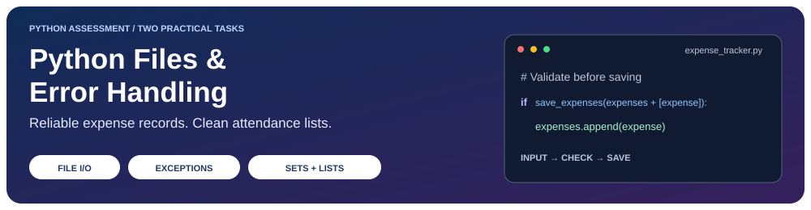
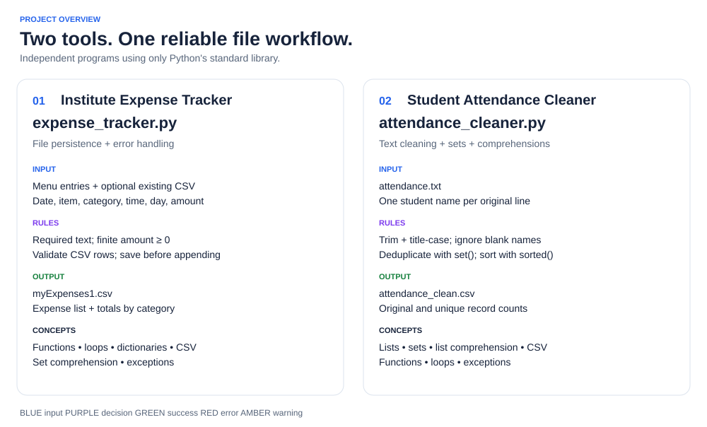
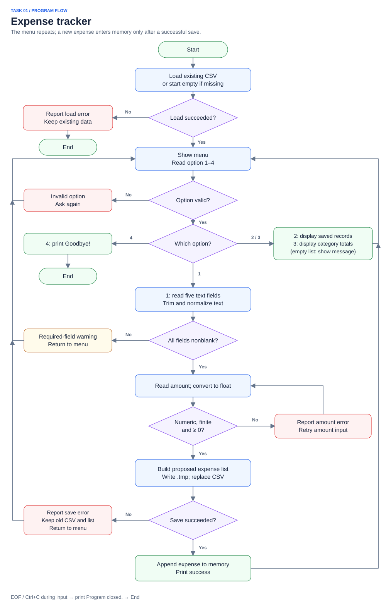
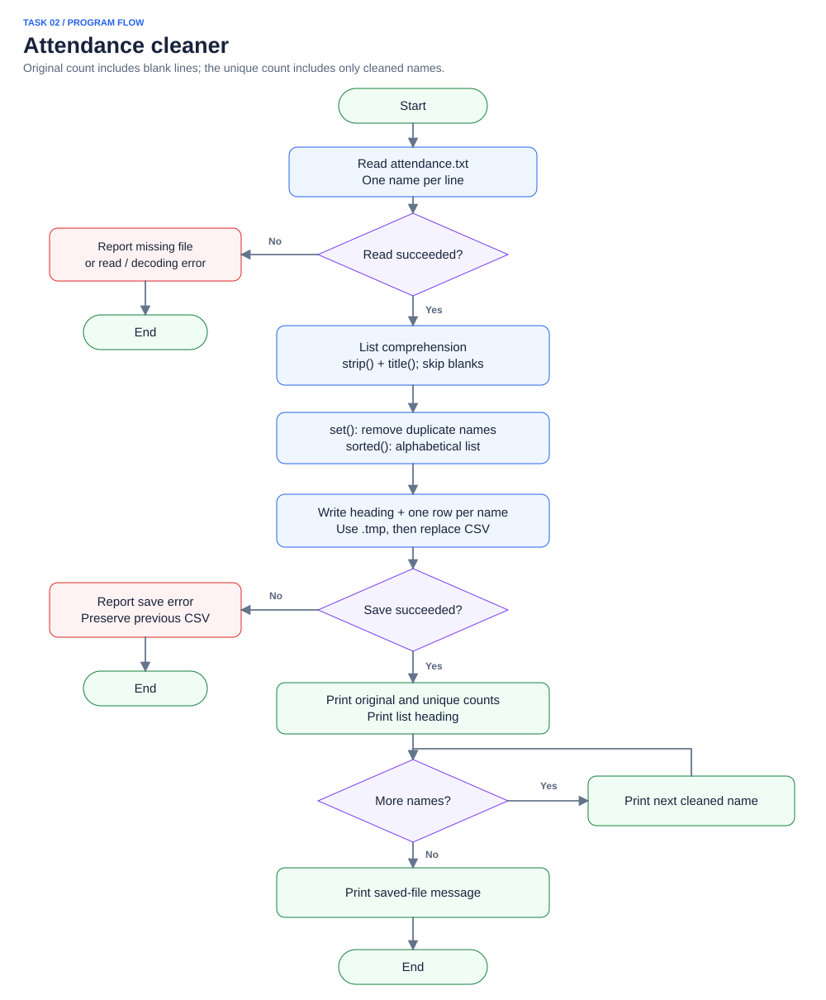
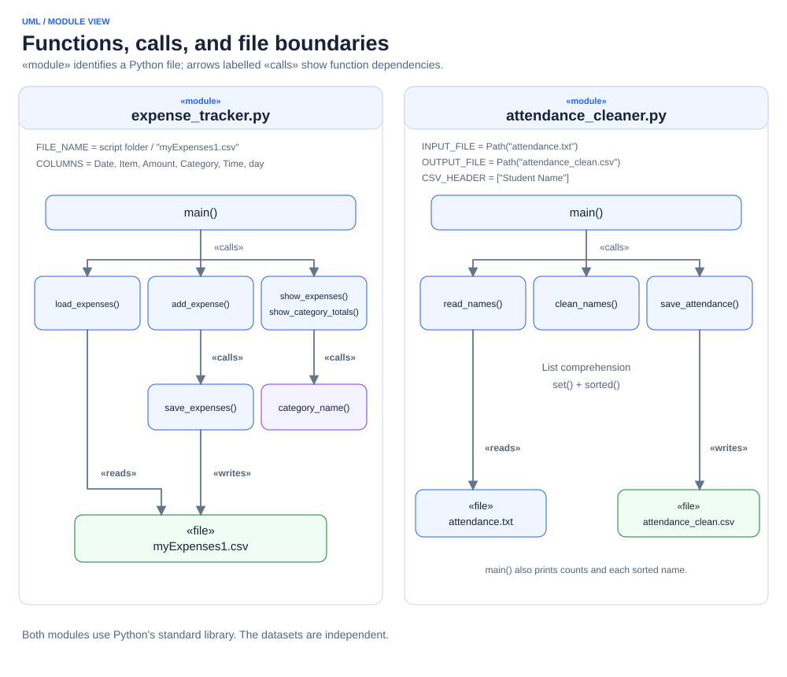

<p align="center"></p>

## 1. Project Overview

Two independent command-line tools solve everyday institute record-keeping tasks: saving expenses between sessions and turning repeated attendance names into a clean register.

**Python standard library only · 58/58 verified scenarios · Python 3.12.14 · Checked 15 November 2026**

| Task | File | Main topics | Result |
| --- | --- | --- | --- |
| Institute Expense Tracker | [expense_tracker.py](expense_tracker.py) | CSV persistence, validation, exceptions, functions, sets | Saved expense history, expense display, category totals |
| Student Attendance Cleaner | [attendance_cleaner.py](attendance_cleaner.py) | Text files, list comprehension, sets, sorting, exceptions | Unique sorted CSV plus original and unique counts |



**Scope and assumptions:** The assessment-brief field was left blank; the supplied README defines the two tasks and repository name used here. No official grading rubric was supplied, so rubric compliance cannot be confirmed. Replace `YOUR NAME` and `YOUR_USERNAME` with your details before submission.

## 2. Folder Structure

```text
python-files-errors-assessment/
├── README.md
├── expense_tracker.py
├── attendance_cleaner.py
├── attendance.txt
└── assets/
    ├── banner.svg
    ├── overview.svg
    ├── expense_tracker_flow.svg
    ├── attendance_cleaner_flow.svg
    └── uml_diagram.svg
```

The four submission files stay at the repository root. `assets/` is the only added folder and contains the five self-contained documentation images. HTML previews and verification support are supplied separately, outside this repository.

| Runtime file | Location and behavior |
| --- | --- |
| `myExpenses1.csv` | Beside `expense_tracker.py`; optional initially, created by the first successful save |
| `myExpenses1.tmp` | Beside the expense script; staged save, replaced on success; may remain after a failed save |
| `attendance.txt` | Read from the terminal's current working directory |
| `attendance_clean.csv` | Created or replaced in the current working directory after successful cleaning |
| `attendance_clean.tmp` | Attendance staging file; replaced on success; may remain after a failed save |

Generated CSVs and temporary files are excluded from the supplied archive. Running both programs from the repository root keeps their data together.

## 3. Task 1 — Institute Expense Tracker

### Summary

`expense_tracker.py` loads previous expense records, repeats a four-option menu, and saves each accepted addition immediately. Expenses are dictionaries held in a list. Category totals use a set comprehension and `sum()` with a generator expression.

### Rules and Requirements

- Menu: **1** add, **2** display, **3** totals by category, **4** exit.
- Date, item, category, time, and day must contain non-whitespace text.
- Amount must convert to a finite `float` and be **zero or greater**; invalid amounts are requested again.
- Trim new text fields, lowercase categories, and title-case day names.
- Load existing records before allowing edits; preserve previous records when saving a new one.
- Write a temporary CSV and replace the main file before appending the new record to memory.
- Show unique categories alphabetically; report blank stored categories as `uncategorized`.

The CSV headings are case-sensitive; their order may vary when loading:

```csv
Date,Item,Amount,Category,Time,day
```

### Program Flow



### Code Methods Description

| Method or section | Purpose |
| --- | --- |
| `FILE_NAME`, `COLUMNS` | Define the script-relative CSV path and exact column headings |
| `load_expenses()` | Read UTF-8/BOM CSV, validate headings and rows, convert amounts; return `None` on failure |
| `save_expenses(expenses)` | Write the complete proposed dataset to a temporary file, replace the CSV, return success/failure |
| `category_name(expense)` | Trim/lowercase category names for grouping; supply `uncategorized` when blank |
| `add_expense(expenses)` | Collect fields, retry invalid amounts, save before updating the list |
| `show_expenses(expenses)` | Display each expense; format amounts to two decimal places |
| `show_category_totals(expenses)` | Build unique categories and total matching expenses |
| `main()` | Load data and repeat menu choices until exit |
| `if __name__ == "__main__"` | Start the CLI; handle end-of-input and keyboard interruption |

### Input Validation

| Input or file condition | Response |
| --- | --- |
| Missing expense CSV | Begin with an empty list |
| Blank required field | Explain the requirement and return to the menu without saving |
| Nonnumeric or blank amount | Explain numeric input and repeat the amount prompt |
| Negative amount, `nan`, infinity, or overflowed float | Reject and repeat the amount prompt |
| Invalid or blank menu choice | Show the valid choices and repeat the menu |
| Wrong/duplicate headings, missing/extra row values, invalid stored amount, malformed quoted CSV | Stop before the menu; leave the file unchanged |
| Read, decoding, or save error | Show a useful error; retain the old data |
| EOF or Ctrl+C during input | Print `Program closed.` and exit without a traceback |

**Deliberate boundaries:** Date, time, and day are required text; calendar validity and agreement are not checked. Amounts use binary floating-point, which is suitable for this exercise but can have rounding limits. This is a single-user file tool; simultaneous writers are not coordinated.

### Expected Results

- A valid new expense is saved once and remains available after a separate restart.
- Viewing records or totals does not rewrite the CSV.
- `Food` and ` food ` share one reporting group; blank stored categories are retained in totals.
- Empty data produces `No expenses recorded yet.`; a failed load prevents editing.
- If a save fails, the original CSV and in-memory records stay unchanged.

## 4. Task 2 — Student Attendance Cleaner

### Summary

`attendance_cleaner.py` reads every line from `attendance.txt`, standardizes nonblank names, removes duplicate cleaned values, sorts them, and exports `attendance_clean.csv`. It prints both counts and the final list only after saving succeeds.

### Rules and Requirements

- Read one student name per input line; the original count includes blank lines.
- Use a **list comprehension** with `strip()`, `title()`, and a blank-line filter.
- Use a **set** to remove duplicates after cleaning.
- Use `sorted()` to order unique names.
- Export one name per CSV row beneath the exact heading `Student Name`.
- Report the original record count and unique student count.
- Catch missing-file, read/decoding, and save errors; preserve previous output when a save fails.

The cleaning steps are explicit in the code:

```python
cleaned_names = [
    name.strip().title()
    for name in original_names
    if name.strip()
]
unique_students = set(cleaned_names)
return sorted(unique_students)
```

### Program Flow



### Code Methods Description

| Method or section | Purpose |
| --- | --- |
| `INPUT_FILE`, `OUTPUT_FILE`, `CSV_HEADER` | Define the input/output paths and exact export heading |
| `read_names()` | Read all original lines using `utf-8-sig`, including files with a UTF-8 BOM |
| `clean_names(original_names)` | Filter blanks, standardize names, deduplicate with a set, return a sorted list |
| `save_attendance(sorted_students)` | Write the CSV heading and name rows to a temporary file before replacing output |
| `main()` | Handle read errors, coordinate cleaning/saving, display counts and names |
| `if __name__ == "__main__"` | Run only when launched directly; handle keyboard interruption |

### Input Validation

| Input or file condition | Response |
| --- | --- |
| Different capitalization or outer spaces | Normalize before checking for duplicates |
| Blank/whitespace-only lines | Include in original count; omit from cleaned names |
| Empty input file | Both counts are zero; export a header-only CSV |
| Missing `attendance.txt` | Explain which file is required; leave prior output unchanged |
| Invalid UTF-8 or inaccessible input path | Report a read error; leave prior output unchanged |
| Output staging/replacement failure | Report a save error; preserve previous CSV and omit success messages |

**Deliberate boundaries:** Names identify entries, not people, so students sharing the same cleaned name are merged. Internal spaces remain unchanged; `Ali  Khan` and `Ali Khan` stay distinct. `title()` uses Python's general casing rules, and sorting uses Unicode string order rather than locale-specific rules.

### Expected Results

- The supplied **15 input lines** become **8 unique names**, sorted from `Ali Khan` to `Zainab Shah`.
- `ali khan`, `ALI KHAN`, and ` ali KHAN ` produce one `Ali Khan` row.
- Empty input creates only the `Student Name` heading.
- The source text file is not edited; a successful run regenerates the cleaned CSV.

## 5. UML Diagram

A **module diagram** fits this procedural project because it shows the real files, constants, functions, and calls without inventing classes.



## 6. Concepts and Techniques Used

- **File I/O:** `with open(...)` closes files reliably; UTF-8/BOM-aware reads support common CSV/text exports.
- **CSV processing:** `DictReader`/`DictWriter` handle expense dictionaries; `csv.writer` safely quotes attendance names.
- **Exceptions and validation:** catch expected failures and use explicit checks for business rules.
- **Functions and constants:** keep responsibilities small and paths/headings consistent.
- **Lists and dictionaries:** store ordered expense records and cleaned attendance data.
- **Sets and comprehensions:** deduplicate categories/names and filter/transform input.
- **Loops and branching:** repeat menus, retry amounts, select actions, and write/display rows.
- **Persistence and save protection:** stage complete output, replace it on success, then update expense memory.

## 7. How to Run

### Requirements

Python **3.10 or later** is recommended; the supplied checks ran on **Python 3.12.14**. No third-party packages, database, or `pip install` step is needed. Both programs use only Python's standard library.

Replace `YOUR_USERNAME` with your GitHub username:

```bash
git clone https://github.com/YOUR_USERNAME/python-files-errors-assessment.git
cd python-files-errors-assessment
python --version
python expense_tracker.py
python attendance_cleaner.py
```

The expense tracker is interactive: choose **4** to exit before running the next command. For attendance, keep `attendance.txt` in the current folder.

| Platform/launcher | Expense tracker | Attendance cleaner |
| --- | --- | --- |
| Linux/macOS alternative | `python3 expense_tracker.py` | `python3 attendance_cleaner.py` |
| Windows launcher alternative | `py expense_tracker.py` | `py attendance_cleaner.py` |

If continuing an existing expense dataset, place `myExpenses1.csv` beside the expense script with the exact documented headings.

## 8. Sample Execution

These transcripts were captured from actual runs in isolated folders on Python 3.12.14. Expense sessions 1 and 2 used separate Python processes and the same saved CSV.

### Expense Tracker — Rejected Inputs, Successful Save, and Restart

<details>
<summary><strong>Session 1: reject abc, -5, and nan; save 250; exit</strong></summary>

Run `python expense_tracker.py`:

```text
No saved expenses yet. Starting with an empty list.

--- Institute Expense Tracker ---
1. Add New Expense
2. Show All Expenses
3. Calculate Total Expenses by Category
4. Exit
Choose an option (1-4): 1
Enter date (DD/MM/YYYY): 15/11/2026
Enter item name: Notebook
Enter category: stationery
Enter time (HH:MM, for example 14:30): 09:30
Enter day (for example Monday): Sunday
Enter amount: abc
Please enter a number, such as 250 or 99.50.
Enter amount: -5
Please enter a finite number that is zero or greater.
Enter amount: nan
Please enter a finite number that is zero or greater.
Enter amount: 250
Expense saved successfully.

--- Institute Expense Tracker ---
1. Add New Expense
2. Show All Expenses
3. Calculate Total Expenses by Category
4. Exit
Choose an option (1-4): 4
Goodbye!
```

The resulting CSV:

```csv
Date,Item,Amount,Category,Time,day
15/11/2026,Notebook,250.0,stationery,09:30,Sunday
```

</details>

<details>
<summary><strong>Session 2: reload, display the saved record, and show its total</strong></summary>

Run `python expense_tracker.py` again:

```text

--- Institute Expense Tracker ---
1. Add New Expense
2. Show All Expenses
3. Calculate Total Expenses by Category
4. Exit
Choose an option (1-4): 2

Date | Item | Amount | Category | Time | Day
15/11/2026 | Notebook | 250.00 | stationery | 09:30 | Sunday

--- Institute Expense Tracker ---
1. Add New Expense
2. Show All Expenses
3. Calculate Total Expenses by Category
4. Exit
Choose an option (1-4): 3

Unique categories: stationery
stationery: 250.00

--- Institute Expense Tracker ---
1. Add New Expense
2. Show All Expenses
3. Calculate Total Expenses by Category
4. Exit
Choose an option (1-4): 4
Goodbye!
```

</details>

### Attendance Cleaner — Successful Cleaning

Run `python attendance_cleaner.py` with the supplied `attendance.txt`:

```text
Original number of records: 15
Unique student count: 8

Cleaned attendance list:
Ali Khan
Ayesha Malik
Bilal Hassan
Fatima Noor
Hamza Iqbal
Sara Ahmed
Usman Ali
Zainab Shah

Saved to attendance_clean.csv
```

The exported CSV:

```csv
Student Name
Ali Khan
Ayesha Malik
Bilal Hassan
Fatima Noor
Hamza Iqbal
Sara Ahmed
Usman Ali
Zainab Shah
```

### Attendance Cleaner — Empty-File Edge Case

With an empty `attendance.txt`, the same command produces:

```text
Original number of records: 0
Unique student count: 0

Cleaned attendance list:

Saved to attendance_clean.csv
```

The output CSV contains only `Student Name`.

## 9. Test Cases

**58/58 scenarios passed** on **Python 3.12.14**. Both source files passed syntax compilation. Tests used actual CLI processes and isolated temporary folders; preservation checks compared file bytes before and after failures. Keyboard interruption was injected at `input()`. Every case below passed.

### Expense Tracker — 41 Scenarios

| # | Scenario | Inputs | Expected result |
| --- | --- | --- | --- |
| E01 | First run without a CSV | Menu 2, 3, 4 | Two empty-data messages; CSV remains absent |
| E02 | Persistence across separate processes | Save 250; restart from another folder | Saved record and category total reload beside the script |
| E03 | Append to existing history | Existing 250; add 75 | Header and both expense rows remain |
| E04 | Category normalization | Food / food / blank; amounts 10 / 20 / 5 | food: 30.00; uncategorized: 5.00; source unchanged |
| E05 | Zero amount boundary | 0 | Accepted and saved once |
| E06 | Decimal amount | 99.50 | Accepted and saved once |
| E07 | Whitespace and CSV quoting | Padded fields; item Notebook, "A5"; FOOD | Text trimmed; category lowercased; day title-cased; quoted item round-trips |
| E08 | Blank date alone | Only date is whitespace | Required-field message; no CSV saved |
| E09 | Blank item alone | Only item is whitespace | Required-field message; no CSV saved |
| E10 | Blank category alone | Only category is whitespace | Required-field message; no CSV saved |
| E11 | Blank time alone | Only time is whitespace | Required-field message; no CSV saved |
| E12 | Blank day alone | Only day is whitespace | Required-field message; no CSV saved |
| E13 | Several required fields missing | All five text fields blank | Required-field message; menu resumes without saving |
| E14 | Invalid amount abc | abc, then 10 | Invalid amount rejected; correction saved once |
| E15 | Invalid amount -1 | -1, then 10 | Invalid amount rejected; correction saved once |
| E16 | Invalid amount nan | nan, then 10 | Invalid amount rejected; correction saved once |
| E17 | Invalid amount inf | inf, then 10 | Invalid amount rejected; correction saved once |
| E18 | Invalid amount -inf | -inf, then 10 | Invalid amount rejected; correction saved once |
| E19 | Invalid amount 1e309 | 1e309, then 10 | Invalid amount rejected; correction saved once |
| E20 | Invalid amount (blank) | (blank), then 10 | Invalid amount rejected; correction saved once |
| E21 | Several invalid amounts in one session | abc, -5, nan, then 250 | Three rejections followed by one successful save |
| E22 | Invalid menu 9 | 9, then 4 | Invalid-option message, then normal exit |
| E23 | Invalid menu (blank) | (blank), then 4 | Invalid-option message, then normal exit |
| E24 | Incorrect header capitalization | Day instead of day | Load refused before menu; file unchanged |
| E25 | Completely empty CSV | Completely empty CSV | Loads as an empty expense list |
| E26 | Header-only CSV | Header-only CSV | Loads as an empty expense list |
| E27 | Reordered UTF-8 BOM headings | Valid headings reversed; BOM included | Expense loads with the correct field values |
| E28 | Missing row value | Missing row value | Row 2 rejected; file unchanged |
| E29 | Extra row value | Extra row value | Row 2 rejected; file unchanged |
| E30 | Invalid stored amount abc | CSV Amount = abc | Row 2 rejected before menu; file unchanged |
| E31 | Invalid stored amount -1 | CSV Amount = -1 | Row 2 rejected before menu; file unchanged |
| E32 | Invalid stored amount nan | CSV Amount = nan | Row 2 rejected before menu; file unchanged |
| E33 | Invalid stored amount inf | CSV Amount = inf | Row 2 rejected before menu; file unchanged |
| E34 | Invalid stored amount 1e309 | CSV Amount = 1e309 | Row 2 rejected before menu; file unchanged |
| E35 | Multiple existing-file errors | Wrong header plus incomplete row and nan | First validation error stops loading; file unchanged |
| E36 | Malformed quoted CSV | Unclosed quoted field | CSV parsing error; file unchanged |
| E37 | Invalid UTF-8 expense file | Bytes FF FE | Decoding error reported; file unchanged |
| E38 | Expense path is a directory | Directory named myExpenses1.csv | Read error reported before menu |
| E39 | Failed save preserves disk and memory | Block myExpenses1.tmp with a directory | Save error; original bytes and displayed records unchanged |
| E40 | End of input | EOF at menu prompt | Program closed.; no traceback |
| E41 | Keyboard interruption | KeyboardInterrupt at input() | Program closed.; no traceback |

### Attendance Cleaner — 17 Scenarios

| # | Scenario | Inputs | Expected result |
| --- | --- | --- | --- |
| A01 | Supplied attendance file | 15 original lines | Original 15; unique 8; sorted CSV matches |
| A02 | Case and outer whitespace |  ali khan / ALI KHAN / aLi kHaN | Original 3; unique 1; sorted CSV matches |
| A03 | Empty input boundary | Zero bytes | Original 0; unique 0; sorted CSV matches |
| A04 | Only blank lines | 3 blank or whitespace lines | Original 3; unique 0; sorted CSV matches |
| A05 | Blank lines with one name | Ali plus 3 blank lines | Original 4; unique 1; sorted CSV matches |
| A06 | Unicode names | ÉVA / Éva / 李 明 | Original 3; unique 2; sorted CSV matches |
| A07 | UTF-8 byte order mark | BOM then ali / ALI | Original 2; unique 1; sorted CSV matches |
| A08 | CSV quoting | noor, sara / SAM "JR" | Original 2; unique 2; sorted CSV matches |
| A09 | Internal spaces remain distinct | ali  khan / ali khan | Original 2; unique 2; sorted CSV matches |
| A10 | No final newline | Single line ali khan | Original 1; unique 1; sorted CSV matches |
| A11 | Missing input preserves output | No attendance.txt; old output exists | Helpful missing-file message; previous CSV unchanged |
| A12 | Invalid UTF-8 input | Byte FF with old output | Read error; previous CSV unchanged |
| A13 | Attendance path is a directory | Directory named attendance.txt | Read error; no CSV created |
| A14 | Failed attendance save | Valid input; blocked temporary path; old CSV | Write error; previous CSV unchanged; no success message |
| A15 | Replace stale cleaned output | New ali entry; old CSV contains another name | CSV contains only the header and Ali |
| A16 | Attendance working-directory behavior | Launch from another folder containing sara | Reads and writes in the working directory |
| A17 | Import has no side effects | Import the module | No output or files created |

---

**Author:** YOUR NAME · **GitHub:** [YOUR_USERNAME](https://github.com/YOUR_USERNAME)
